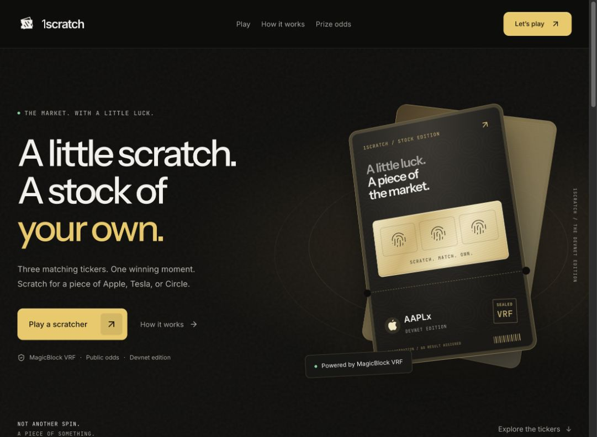

# 1Scratch

**Scratch. Match. Own.**

1Scratch turns a familiar scratch card into the start of a little portfolio. Pick Apple, Tesla, or Circle, buy a $1 card with devnet USDC, and scratch to reveal three tickers. Three matching tickers mean a winning card. Claim your prize as devnet stock tokens, then hold them in your wallet or sell them to the demo treasury.

Built on Solana with **MagicBlock VRF** for the prize draw and **MagicBlock Ephemeral Rollups (ER)** for the scratch and reveal.

**Explore the working integration:** [Deployed game program](https://explorer.solana.com/address/CwvfeJmKV5cEJwrUU3M12C3d97vf7MyUoT6BnSCJNqCP?cluster=devnet) · [VRF request on ER](https://explorer.solana.com/tx/45U9ihPYjS4PyZTNBNwF5RBNdyiJsgkZCuyP2SgWxueUrhLkCdTEfLBLPp29tB2QwrtV5h4maMAWZSh1SzVKknMS?cluster=custom&customUrl=https%3A%2F%2Fdevnet-as.magicblock.app%2F) · [VRF callback on ER](https://explorer.solana.com/tx/2qry4Xuu5dZ6du3TunAP5hnSy1xy7XCGpseQ26BkiyrYsbG6U7DrVA7adPBdwX7d9jqxrZ1qnsah3MVCEF4HjdxE?cluster=custom&customUrl=https%3A%2F%2Fdevnet-as.magicblock.app%2F) · [Token payout on Solana](https://explorer.solana.com/tx/4Z25qV2jP7m2RbQZ5ECsBVi9EJacyMWcQ7LQZXNDKx796drqGy6tDjN5Z2bcAQ3UYqBebRYbHE4z2dokbWZRd3BS?cluster=devnet)

> **Devnet edition:** the game uses devnet USDC and stock-themed devnet tokens. These tokens are not company shares.

## A completed game you can check

This is the actual journey of **Card #12: a 1x TSLAx win**, rechecked against Solana and MagicBlock ER history on **November 27, 2026**.

| Step                                                      | Where it happened | Open the transaction                                                                                                                                                                                                      |
| --------------------------------------------------------- | ----------------- | ------------------------------------------------------------------------------------------------------------------------------------------------------------------------------------------------------------------------- |
| 1. Buy the card and send its gameplay state to MagicBlock | Solana devnet     | [Buy + delegate](https://explorer.solana.com/tx/53UANEKHo88VbJ9FnYNNW4SMfAp89cqt6ScZj9GfpHcAuDQBregASRFoTjaVwpeS24h1HjdVWXYubo39PCoaUK8X?cluster=devnet)                                                                  |
| 2. Ask MagicBlock VRF for a random result                 | MagicBlock ER     | [Scratch / VRF request](https://explorer.solana.com/tx/45U9ihPYjS4PyZTNBNwF5RBNdyiJsgkZCuyP2SgWxueUrhLkCdTEfLBLPp29tB2QwrtV5h4maMAWZSh1SzVKknMS?cluster=custom&customUrl=https%3A%2F%2Fdevnet-as.magicblock.app%2F)       |
| 3. Receive the VRF answer and record the prize            | MagicBlock ER     | [VRF callback](https://explorer.solana.com/tx/2qry4Xuu5dZ6du3TunAP5hnSy1xy7XCGpseQ26BkiyrYsbG6U7DrVA7adPBdwX7d9jqxrZ1qnsah3MVCEF4HjdxE?cluster=custom&customUrl=https%3A%2F%2Fdevnet-as.magicblock.app%2F)                |
| 4. Finalize the result and return the card to Solana      | MagicBlock ER     | [Settle / commit + undelegate](https://explorer.solana.com/tx/Nfbsie1wBnwUNmskNw3eTVE5aBcj6Y3KrQmLwm1Kn4r1ytLn1kcLMBfhGPofaiKLbQ8dTSquiTU2WCWLWsZiESa?cluster=custom&customUrl=https%3A%2F%2Fdevnet-as.magicblock.app%2F) |
| 5. Receive the winning tokens in the wallet               | Solana devnet     | [Claim payout](https://explorer.solana.com/tx/4Z25qV2jP7m2RbQZ5ECsBVi9EJacyMWcQ7LQZXNDKx796drqGy6tDjN5Z2bcAQ3UYqBebRYbHE4z2dokbWZRd3BS?cluster=devnet)                                                                    |
| 6. Sell those tokens back to the demo treasury            | Solana devnet     | [Treasury sale](https://explorer.solana.com/tx/nLUzxgmnGQMYUnM5R6csQsuc3uH4XtHPMkEAdPhGMoLZpHniRFTcJ4JB3T78N6uux85qc224hB7YyyNCgZgRJUM?cluster=devnet)                                                                    |

The claim transferred **0.00256352 devnet TSLAx** into the player's wallet. The wallet then sold that amount for **0.999998 devnet USDC**. These are the actual recorded amounts.

There is also a **2x TSLAx win on Card #11**: [VRF callback](https://explorer.solana.com/tx/5diYtoDJZurTtknxdZdYqJBQHpK1MNVcP5CukGPN4oqfHbzAoe6jQrnLtq5oxCGVJF9BroDGTBidFt3MQQnUSkqZ?cluster=custom&customUrl=https%3A%2F%2Fdevnet-as.magicblock.app%2F) → [payout transaction](https://explorer.solana.com/tx/2Qr5iudLwfvFNsYY5BJy21WGuRrgjXNzkjvVpPVZc1o87FpQPdP9RMxWHki5E95W5vtpnK2Tb9u7Kydw7XbojwAu?cluster=devnet).

[View both card receipts and the checked on-chain data](docs/DEVNET_EVIDENCE.json). ER links use the card's MagicBlock RPC as Solana Explorer's custom cluster.

## Why Entertainment Finance?

**The entertainment is the scratch, the reveal, and the chance of matching three tickers. The finance is what you receive and keep afterward.**

A winning card gives you tokens in your own wallet. You can see their reference value in your portfolio, hold them as that value moves, or exchange them for devnet USDC through the treasury. Even a 1x, money-back win becomes a token holding whose value can change after you claim it.

1Scratch is inspired by [MagicBlock's Stock Scratchers idea](https://x.com/magicblock/status/2123416325347569893): a scratch-card experience that connects the fun of a reveal with receiving a stock-themed asset.



## The player's journey

1. **Connect a wallet.** Use Phantom or Solflare in a browser and select devnet.
2. **Choose your ticker.** Pick Apple (`AAPLx`), Tesla (`TSLAx`), or Circle (`CRCLx`). Every ticker uses the same entry cost and prize odds.
3. **Buy a sealed card.** The current entry is 1 devnet USDC, plus devnet SOL for transaction costs and the delegation deposit.
4. **Scratch to reveal.** Drag across the foil, or use **Reveal without scratching**. MagicBlock supplies the random result.
5. **Check the three symbols.** Three copies of your chosen ticker signal a win. One or two matching symbols do not pay a prize.
6. **Claim and choose what comes next.** Claim winning tokens to your wallet. View them in your portfolio, hold, or sell to the demo treasury. A losing card can be finished without a token payout.

For an Apple card:

| Revealed symbols        | Result                                                |
| ----------------------- | ----------------------------------------------------- |
| `AAPLx · AAPLx · AAPLx` | A winning card; the prize table determines the payout |
| `AAPLx · TSLAx · CRCLx` | No three-way match; no prize                          |

The selected ticker is fixed when you buy. MagicBlock VRF chooses the prize tier first, and the app displays a matching or nonmatching pattern for that result. The three positions are not independent random draws. Scratching reveals the result; the way you move your pointer does not change the prize.

## What MagicBlock does

### VRF: the random prize draw

**VRF means Verifiable Random Function.** 1Scratch requests randomness from MagicBlock's VRF oracle. When its answer arrives, the game uses those random bytes to select a tier from the card's public prize table.

The table is saved with the card when it is bought. That means the card's prize calculation uses the odds attached to that purchase. The app displays those odds before play and lets readers recompute a completed card's payout from the saved randomness.

The [request above](https://explorer.solana.com/tx/45U9ihPYjS4PyZTNBNwF5RBNdyiJsgkZCuyP2SgWxueUrhLkCdTEfLBLPp29tB2QwrtV5h4maMAWZSh1SzVKknMS?cluster=custom&customUrl=https%3A%2F%2Fdevnet-as.magicblock.app%2F) invokes MagicBlock's VRF program, and the [callback above](https://explorer.solana.com/tx/2qry4Xuu5dZ6du3TunAP5hnSy1xy7XCGpseQ26BkiyrYsbG6U7DrVA7adPBdwX7d9jqxrZ1qnsah3MVCEF4HjdxE?cluster=custom&customUrl=https%3A%2F%2Fdevnet-as.magicblock.app%2F) calls the 1Scratch game program with the answer.

### ER: where the scratch and reveal run

**ER means Ephemeral Rollup.** Think of it as the card's gameplay desk: the card's state temporarily runs in MagicBlock's execution environment while the scratch request and VRF answer are processed.

When the player finishes, the result is committed back and the card is returned to Solana. Buying, prize-token ownership, payouts, and treasury sales are recorded on Solana devnet.

| Part of the journey | Job                                                                                       |
| ------------------- | ----------------------------------------------------------------------------------------- |
| **Solana**          | Records the purchase, holds prize inventory, transfers tokens, and handles treasury sales |
| **MagicBlock ER**   | Runs the delegated card's scratch request, VRF callback, and settlement request           |
| **MagicBlock VRF**  | Supplies the randomness used to choose the prize tier                                     |

The app's **Verify this card** panel exposes the transactions and checks the payout calculation. The receipts and arithmetic check are inspectable evidence; the panel does not independently verify the oracle's cryptographic proof.

## Public prize table

This is a **prize table**: it describes the possible payouts and their chances. Stock reference prices are shown separately.

The current deployed $1 card has these odds:

| Card outcome          | Chance | Reference value paid in devnet tokens |
| --------------------- | -----: | ------------------------------------: |
| No match · 0x         |    62% |                                    $0 |
| Money back · 1x       |    30% |                                    $1 |
| 2x                    |     5% |                                    $2 |
| 5x                    |     2% |                                    $5 |
| 10x                   |   0.9% |                                   $10 |
| 100x                  | 0.099% |                                  $100 |
| Rare jackpot · 1,000x | 0.001% |                                $1,000 |

**Total winning-card chance: 38%.** The 1,000x tier has a 1-in-100,000 chance. These are probabilities for each card, not a promised number of wins across a small set of attempts. The configured theoretical return is 69.9% of entry value before fees.

The app reads the active table from the [on-chain House account](https://explorer.solana.com/address/6ueXccthuD73jY93851FVTztKBPAyv8UxwTzit9UKNc9?cluster=devnet), and each purchased card saves its own copy.

### What a 1x win actually gives you

A 1x result on a $1 card means **$1 worth of your chosen devnet token at claim time**. It does not mean one whole token or share, and transaction fees are separate.

For a simple example, if the reference price were $200, a $1 prize would become roughly 0.005 tokens. Holding that amount while the reference price moved to $220 would give it a displayed value of about $1.10; at $180 it would display about $0.90.

The token quantity stays in your wallet until you transfer or sell it. Its displayed value follows the reference price.

## What you can do in the app

- **Explore the landing page:** learn the rules, view reference prices, and read the public prize table.
- **Pick a stock:** Apple, Tesla, or Circle. Ticker links open the game with that choice selected.
- **Play a scratch card:** use the foil interaction or the reveal button.
- **Receive a VRF result:** the prize comes from the on-chain game, and the screen shows the matching pattern and multiplier.
- **Claim to your wallet:** winning payouts become wallet-held devnet tokens.
- **Track a portfolio:** see token quantities, reference prices, and total reference value.
- **Hold or sell:** preview a treasury sale quote and confirm the sale for devnet USDC. The transaction enforces the quoted minimum output.
- **Resume a card:** reconnect the purchasing wallet and reopen a card by its number.
- **Inspect a receipt:** open buy, scratch, VRF callback, settlement, and claim transactions.
- **Get devnet funds when configured:** the optional Funds action supplies the demo's devnet USDC and devnet SOL.
- **Use desktop or mobile layouts:** the landing page, stock picker, portfolio, and scratch dialog adapt to screen size.

Reference prices are updated by the project's keeper using Jupiter token quotes, with configured fallback prices when a live quote is unavailable. The game rejects stale prices for claims and treasury sales. The treasury has finite devnet inventory; sales depend on an accepted fresh quote and available funds.

## Try 1Scratch locally

Use Node.js 22 or later:

```sh
npm ci
npm --prefix app ci
cp app/.env.example app/.env.local
npm --prefix app run dev
```

Open **http://localhost:3000/** for the landing page or **http://localhost:3000/play** for the game. To buy cards, use a wallet-enabled browser on devnet with devnet SOL and this game's devnet USDC.

The frontend uses the existing devnet deployment. Keeping claim and sale prices fresh requires the authorized price keeper to be running. [Setup, funding, keeper, build, and verification instructions](docs/DEVELOPMENT.md) are in the development guide.

## For builders and reviewers

- [Game program on Solana devnet](https://explorer.solana.com/address/CwvfeJmKV5cEJwrUU3M12C3d97vf7MyUoT6BnSCJNqCP?cluster=devnet)
- [Game rules, VRF request, callback, and payout code](programs/scratchers/src/lib.rs)
- [Frontend transaction journey](app/lib/game.ts)
- [Receipt verification logic](app/lib/verification.ts)
- [Recorded devnet receipts](docs/DEVNET_EVIDENCE.json)
- [Development guide](docs/DEVELOPMENT.md)
- [Architecture and development notes](docs/PLAN.md)
- [Design system](brand.md)

The application is branded **1Scratch**. Its deployed program and internal crate remain named `scratchers`.
